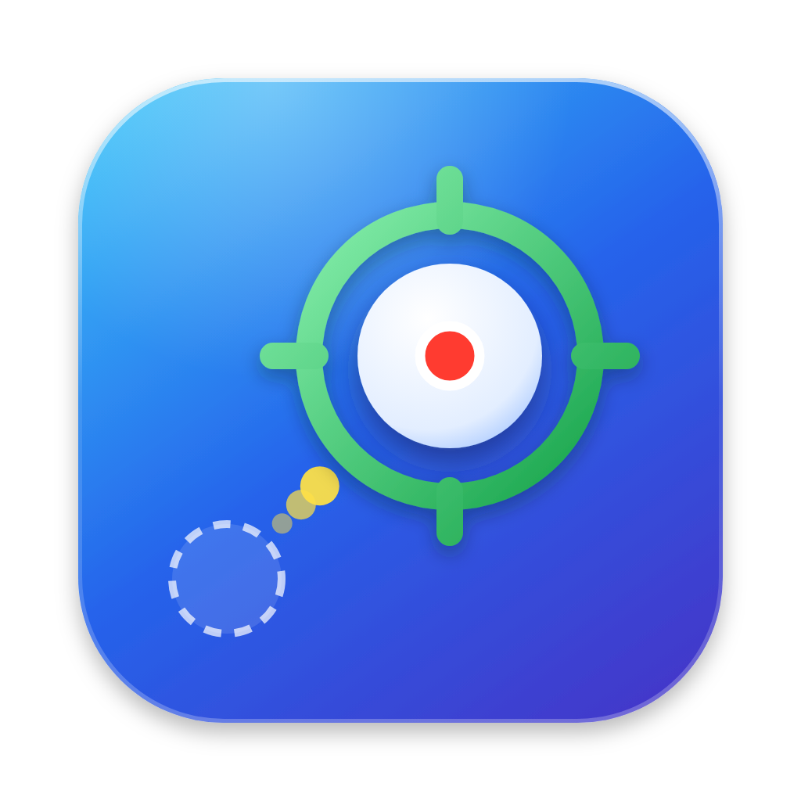

# OITem Pillar Tracker

マイクロピラーの先端を動画から追跡し、変位と力を求める解析ツールです。培養筋などがピラーを引く様子を撮影した動画を読み込み、ピラー先端の位置をフレームごとに求めます。

- **Web 版**：https://nu-0.github.io/OITem-Pillar-Tracker/ （インストール不要。ブラウザで開くだけで使えます）
- **ネイティブ版（macOS / Windows）**：Web 版と同じ画面で、解析を Python + OpenCV で高速に行います。複数の動画を並列に処理し、AVI などブラウザで再生できない形式も読み込めます。入手方法とビルド方法は [native/README.md](native/README.md) を見てください。

## できること

- ROI（ピラー先端を囲む円・四角）を 1 フレームで指定すると、テンプレートマッチングで前後のフレームを追跡します。
- 変位（px・µm）と力（ばね定数から換算）をグラフ・CSV・Excel で出力します。
- 複数の動画をグループ（色タグ）に分けて重ねて比較できます。
- 解析条件と結果をログ（.json）に保存し、後から同じ条件で再解析・照合できます。
- **自動 ROI**（v2.11.0〜）：手動で ROI を描いて解析するたびに、ROI と画像が学習データとして保存されます。データがたまると、新しい動画の ROI を自動で置けます。研究室の共有フォルダを保存先にすると、全員のデータをまとめて使えます。

## 使い方（概要）

1. 動画を追加します（ドラッグ＆ドロップでも可）。
2. 見やすいフレームでピラー先端をドラッグして ROI を描きます。学習データがあれば「自動 ROI」でも置けます。
3. FPS・スケール（µm/px）・ばね定数を設定し、「解析」を押します。
4. グラフや CSV・Excel で結果を確認・保存します。

画面左下の「使い方」にも詳しい説明があります。

## 構成

| パス | 内容 |
|---|---|
| `index.html` | Web 版（このファイル 1 つで動きます） |
| `opencv.js` | OpenCV.js（オフライン用。ライセンスは `LICENSE-opencv.txt`） |
| `native/` | ネイティブ版（Python）のソースとビルド設定 |
| `.github/workflows/` | ネイティブ版を自動ビルドする設定 |

`index.html` を更新して push すると、ネイティブ版の画面も自動で作り直されます。

## ライセンス

OpenCV.js は Apache License 2.0 です（`LICENSE-opencv.txt`）。
